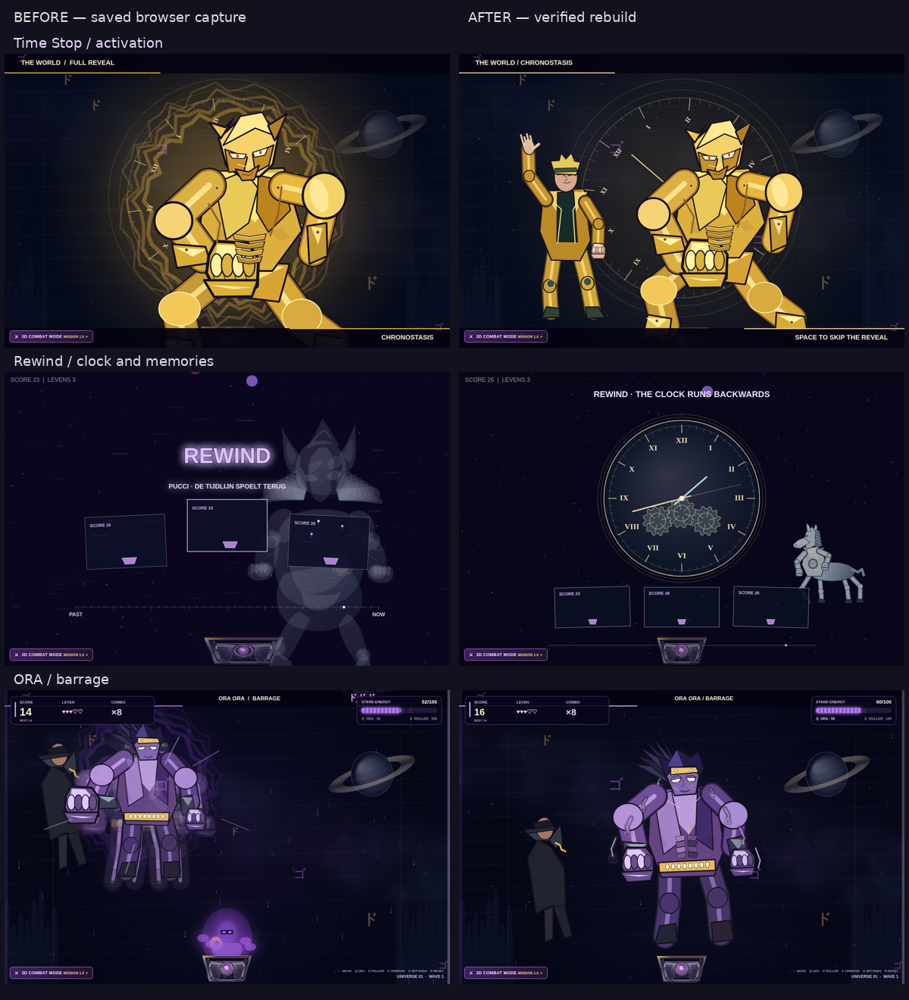
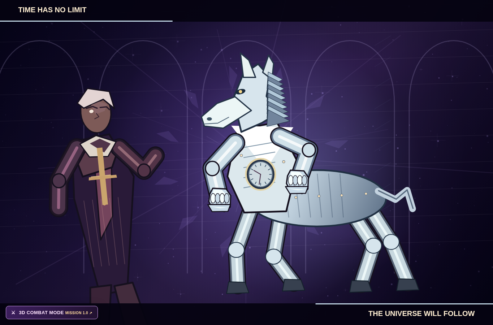
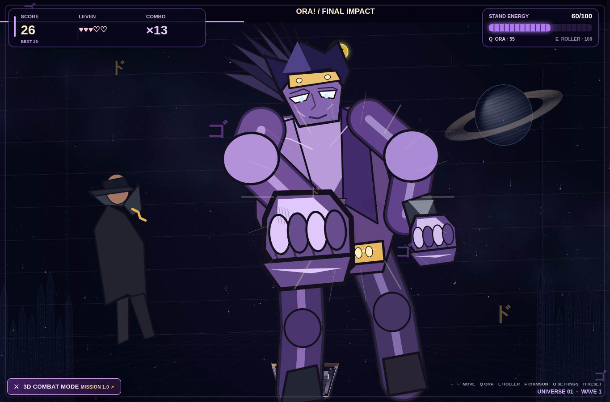

## Persoonlijke audio hersteld

Op verzoek zijn de oorspronkelijke JoJo-stemmen (Pucci, tijdversnelling, ORA en ZA WARUDO), achtergrondmuziek, Giorno-theme en game-overgeluid weer de standaard. De gebruiker heeft aangegeven dat dit voor persoonlijk gebruik is. De gebruiksrechten van deze oorspronkelijke clips zijn niet geverifieerd; er wordt geen vrije licentie geclaimd. De nieuwe CC0-scène-effecten en verbeterde audio-cleanup blijven behouden. De bestaande hosting is hierdoor niet technisch afgeschermd.

# Cinematic rebuild — 13 October 2026

Continues the current normal Catcher game, not a separate demo. A baseline was reviewed from the two uploaded gameplay recordings and prior 1365×900 browser screenshots.

## Changes

- Pucci: a separate priest silhouette and prayer/entry composition. Made in Heaven now has a long muzzle, ears, plated mane, four articulated equine legs, hocks, hooves, tail and sternum clock. The Stand manifests beside Pucci in a chapel-like scene rather than a generic upright figure.
- Rewind: a central clock with three meshing gears and separately rotating hands moves backwards with increasing speed. Three recorded-data memory panes remain visible. They are reconstructions of recorded ball/catcher/score state, not captured framebuffer/video playback.
- Acceleration: daylight cycles, moving skyline and lengthening star trails establish a changing environment. Collapse lasts 3.6 seconds with an accretion core and orbiting recorded-game panes. The final screen-wide flash was removed. Rebirth lasts 4.6 seconds, progressing from a seed to stars/nebula, environment and the actual reset playfield.
- Time Stop: DIO and The World share the activation scene; the Stand locks its pose before the freeze. The paused playfield stays visible with a compact remaining-time display. Release uses expanding rim fragments and rings while movement returns under the existing game rules.
- ORA: six compositions with torso twist, connected shoulder/elbow/forearm motion, alternating arm silhouettes, a large articulated finishing fist and recovery. Finisher damage still uses the existing gameplay resolver.
- Audio: twelve new local mixes built entirely from Kenney CC0 recordings. Their exact sources and reproducible mix script are in ASSET_CREDITS.md and tools/build_cinematic_foley.py. No supplied anime clip is automatically published; private file selectors are preserved, including Time Stop.
- Fixed the fixed-duration ORA cutoff for longer local clips, retained audio-clock progress, added synchronized pause/resume, reset/skip cleanup, silent missing-recording fallback and ambient-music shutdown at Game Over.

## Verified results

Local tests pass: Arcade gameplay, 212 cinematic render calls at four sizes, longer-clip ORA duration, missing-voice bounded reset completion, audio/reset cleanup and 21 combat rules checks. These are simulation/draw-call tests, not a perceptual art or audio quality rating.

[Full cinematic/lifecycle browser run 38320570986](https://github.com/RyanDb020/Catcher-JoJo/actions/runs/38320570986), source `2fe18c1e3763a7282117ac91be85796c6970a7ae`: both jobs passed. The real Chromium Arcade route captured 22 screenshots covering six ORA phases, Pucci/Stand manifestation, two reversed-clock moments, acceleration, collapse, rebirth, return to play and natural Game Over. Console/page/request/bad-response error lists were empty; 37 playback calls were recorded. The protected normal-play segment was 10.004 seconds, not a ten-minute endurance test.

The dedicated browser routes passed with every cinematic MP3 request aborted: initial boot, Time Stop through resume, ORA through recovery, full Rewind through reset, and Space skip cleanup. A 14.2-second locally selected licensed fixture remained active beyond the old ORA cutoff. Pausing held the game clock and the native clip position, and resuming completed the scene.

An earlier audio-fault run stalled before startup; sound loading was moved out of blocking p5 preload. The final ORA screenshot also exposed an extra third fist: the follow-up extends the existing articulated leading arm instead.

The recorded scores were technically decoded and level-limited, and actual native-browser playback/timing was exercised. Speaker/headphone sound quality was not listened to. Character art remains stylized procedural Canvas2D linework; no imported production character artwork or rigged anime models are supplied.

## Uploaded audio review

All 17 MP3s were decoded and measured; UPLOADED_AUDIO_REVIEW.json contains duration and peak measurements. Names provide candidate associations, not a confirmed listening identification. No licence granting public redistribution was supplied. Existing uncertain anime/music clips were removed from the current release tree and replaced with recorded CC0 cues; old repository history is not rewritten. Perceptual speaker/headphone quality has not been verified in this environment.

## Final visual follow-up

[Run 38321136617](https://github.com/RyanDb020/Catcher-JoJo/actions/runs/38321136617), source `8cd19a3ec435e17bd2b99019f955654bec97a7d8`: both jobs passed after the attached-arm finisher correction. Arcade console/page/request/bad-response lists remain empty; the protected play segment was 10.006 seconds. The audio-fault/lifecycle route was not repeated for this character-drawing-only change; its successful result is from the full run above. The five-wave Combat mission was not repeated by these Arcade-focused passes.

The comparison uses actual saved browser captures at the same 1365×900 viewport and comparable phases, from separate rounds. Scores, ball positions and exact normalized instants differ; these are not an identical seeded replay. No mockup is presented as gameplay.

The character drawings remain visibly geometric and stylized. They are functional procedural illustrations, not a claim of finished production anime art. No perceptual audio listening test was possible. The new tracks' source/licence and technical playback checks are verified; subjective visual quality and speaker/headphone mix quality remain open for review.
