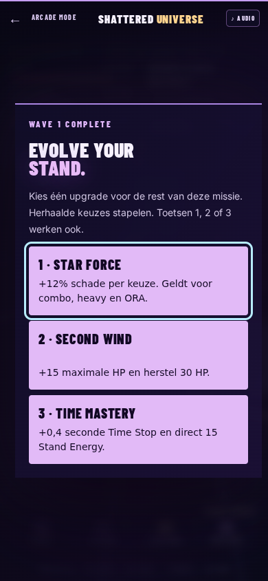
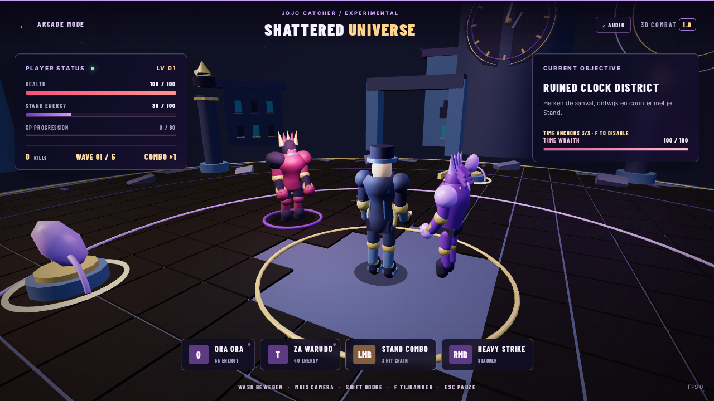
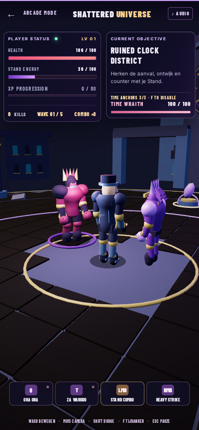
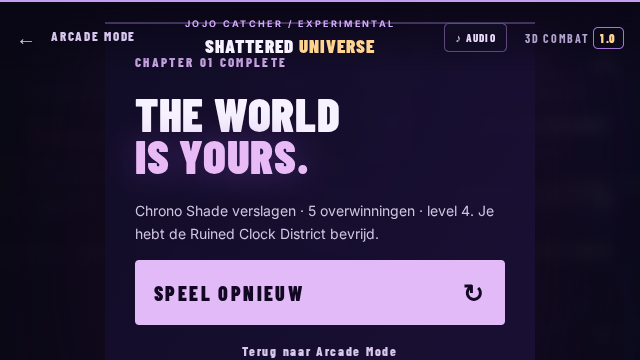
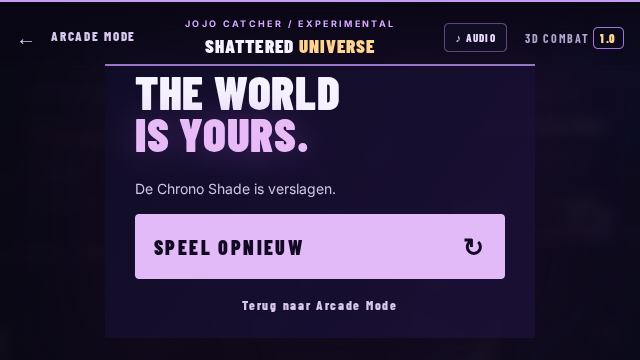

# Visual, foley and combat polish — 12 October 2026

This continues the existing `Game 1` project. It is a polish checkpoint, not a claim that every requirement in the supplied 10,000-word release brief is complete.

## Implemented

- Fixed the initial perspective camera aspect ratio. It used 1:1 before the first resize, stretching the models on a wide display. Portrait rendering now uses a wider field of view and additional camera distance.
- Added separate elbow and knee pivots to the player, Stand and enemy; the distal meshes preserve their rest pose. Guard stance, walking knees, punch extension, torso twist, recoil and recovery now involve multiple joints.
- Refined the player with skin, a shaped cap bill, coat collar, chain links, buttons, rear seams and finger/knuckle details. Added Stand abdomen segments and swept-back hair. Adjusted body proportions and ground height.
- Added distinct silhouette kits for stalker, guardian, adept and boss. Brighter costumes, a lower mask that does not cover the eyes, and moving fill lights improve enemy readability.
- Stand staging chooses the open camera side, opposite a nearby opponent, and faces the target. Body spacing prevents a live enemy and player occupying the same position. Time Stop does not push the frozen enemy along with a moving player.
- Turned district facades inward so their windows and detailing face the plaza. Replaced separated hexagonal islands with coherent paving and restrained gaps, while keeping the clock tower, ruins and time anchors.
- Kept the existing off-center hit notifications. Compacted ability cards on portrait displays. Raised audio controls above overlays so volume and mute remain usable while paused.
- Perfect dodge now requires a nearby announced strike inside the late dodge window; its invulnerability covers the Echo slow and strike. Time Stop freezes enemy poses as well as AI. Short hitstop also holds player actions and animation.
- Integrated 16 original Kenney CC0 Ogg files and replaced seven Arcade MP3 effects with converted recordings. Concrete steps, light hit variants, heavy impact, cloth movement, attack swings, guard and enemy preparation have event-specific mappings. Exact sources and edits are in `ASSET_CREDITS.md`.
- Limited audio repetition, active voices per event and total one-shots. Pause/mute/replay stop short sources, and delayed loading cannot replay an old hit. Added a recorded clock/metal/cloth release cue to both modes; kept the remaining ambient/music/activation cues and user-supplied voices.
- Catcher collision now checks entry at the bucket rim rather than accepting contact deep along the bucket wall. The existing swept crossing check remains for fast balls.

## Continued combat work

- Added one required upgrade choice after each of the first four waves. Star Force adds 12% damage per selection; Second Wind adds 15 maximum HP and heals 30; Time Mastery adds 0.4 seconds to Time Stop and grants 15 energy. Upgrades stack during one mission and are cleared on replay.
- The shared selection dialog works with buttons and 1/2/3 keys in WebGL and Canvas2D. Simulation, input and one-shot audio stop while choosing. Portrait and short displays can scroll the dialog.
- Chrono Shade retains the close strike, adds a locked eight-metre Time Lance in phase two, and alternates a 4.4-metre sweep with the lance in phase three. Ground telegraphs show the attack footprint. The lance locks its direction at windup, allowing a sideways dodge.
- Boss attacks and recovery cannot be reset indefinitely by repeated heavy hits. Its 1.15-second recovery remains a damage counter window. Time Stop still freezes its attacks; perfect dodge checks the same attack footprint as damage.
- The engine-neutral suite now includes upgrade effects/reset, boss armour, frozen lance timing, a sideways dodge and the final-phase sweep. The full WebGL mission runner selects all three upgrade types, checks that selection freezes combat, captures the portrait dialog and verifies clean replay.

## Verification

The local regression suite passes, including Arcade gameplay, 156 cinematic render calls at four sizes, 3D rules, asset-path validation and new audio lifecycle checks. These are code/simulation checks, not a listening test.

Chromium cannot be installed in this local workspace: the download returns an empty/truncated archive. Browser verification therefore uses the existing GitHub Actions Chromium/SwiftShader workflow. Early runs exposed an overlay blocking mute; that UI issue was fixed. A gait check was changed from a single timed snapshot to waiting for actual rendered movement. The mission navigator now reports complete state if it cannot reach an anchor.

### Completed browser runs

| Run | Revision | Scope | Result |
| --- | --- | --- | --- |
| [Full mission + Arcade](https://github.com/RyanDb020/Catcher-JoJo/actions/runs/38312201430) | `0b33400` | Chromium/SwiftShader: WebGL, keyboard movement, joints, spacing, 1280×720 and 390×844 layouts, 14 decoded audio banks, pause/mute, all three anchors, Time Stop, all five waves, boss defeat, victory and replay; separate Canvas2D fallback. Arcade: Time Stop, Road Roller, ORA, all Rewind phases, return to gameplay, 10-second protected session and natural Game Over. | Both jobs passed. Boss HP 0, 5 kills, level 4; replay HP 100, wave 1, 3 anchors, no lingering Time Stop. |
| [Upgrades + boss mission verification](https://github.com/RyanDb020/Catcher-JoJo/actions/runs/38314771054) | `2fdd8a2` | Node regression (21 combat checks); full WebGL mission with four upgrade choices, all three upgrade types, paused simulation during selection, portrait upgrade UI, victory/replay, fallback smoke and full Arcade cinematic route. | Both jobs passed. Victory: HP 145/145, 5 kills, level 4, upgrades power 1 / vitality 2 / time 1. Replay: HP 100, wave 1, three anchors, zero upgrades. |
| [Short-window overlay follow-up](https://github.com/RyanDb020/Catcher-JoJo/actions/runs/38315614992) | `decea9c` | Real WebGL wide/portrait, audio lifecycle, Canvas2D fallback; isolated victory dialog layout at 640×360; full Arcade cinematic route. The five-wave mission was not repeated for this CSS change. | Both jobs passed. Victory panel spans y=64–338 and its replay button y=214–279 inside a 360 px window. |
| [Recorded release cue verification](https://github.com/RyanDb020/Catcher-JoJo/actions/runs/38313253786) | `927396a` | Node regression plus WebGL/layout/audio lifecycle/fallback smoke and the full Arcade cinematic route after the audio/cache updates. The five-wave mission was not repeated in this audio pass. | Both jobs passed; recorded resume/rebirth playback appears in the Arcade event trace. |

Arcade reports contain empty console/page/request/bad-response error lists. The full run recorded 40 audio playback calls and 17 Arcade screenshots. This confirms requests/playback paths, not audible speaker quality. The session was 10 seconds of protected normal play, not the runner's optional ten-minute endurance mode. The legacy `commitBase` field in the first report was stale; the table uses the actual workflow head SHA. The follow-up report now records `GITHUB_SHA`.

The upgrade mission used Time Stop and finished while it was active. It verifies the mission route, not a balanced fight or visible execution of every boss pattern; attack footprints and frozen timing also have engine-neutral tests.

The three live voice assets match their local copies: Made in Heaven 8.664000 s, Time Accelerate 8.881633 s and ORA 8.359184 s. Their existing timelines were retained, not rebuilt in this pass.

Screenshots below are captured from the actual game. The victory image is from the full mission run; layout images are from the follow-up browser run. Software rendering is slow and is not a benchmark for the user's GPU.

The final checkpoint bumps the module query versions together to 1.6.2 so an already-open browser cannot combine cached pre-upgrade rules with the new modules. These URL-only changes do not alter the tested combat logic.

## Release brief still open

- A complete art review of all character faces and poses, including the three Arcade cinematics, remains required. This pass refines existing procedural models; it does not supply externally authored production character meshes.
- The full cinematic redesign and fine synchronization of all existing voice tracks have not been redone in this pass. Arena ORA still uses its existing short combat ability timeline, distinct from the longer Arcade presentation.
- Remaining ambient/music/summon/time-activation cues are still the existing generated sounds; the time-resume cue now uses recordings. The complete sound mix has not received a perceptual listening review; not every requested event has a new recording.
- Wave upgrade choices and three boss attack patterns are implemented. A full persistent mastery/progression system remains open; the upgrades last for one mission.
- Browser smoke/mission checks do not establish combat balance, sustained performance on the user's GPU, or subjective game feel. Existing voice/music redistribution rights remain unresolved as documented in the project notices.

Keep these items open when continuing from this checkpoint. Do not describe this build as the completed masterprompt release.
