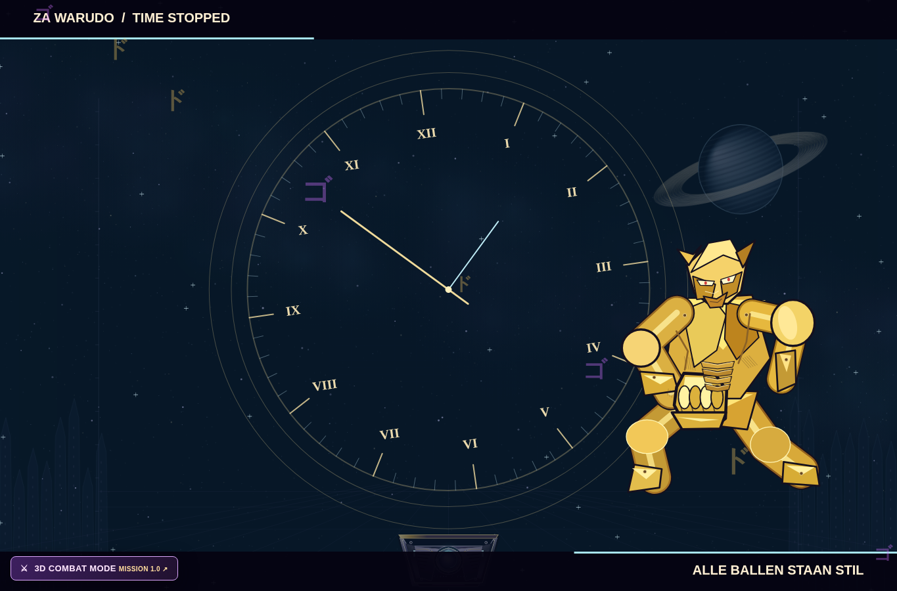
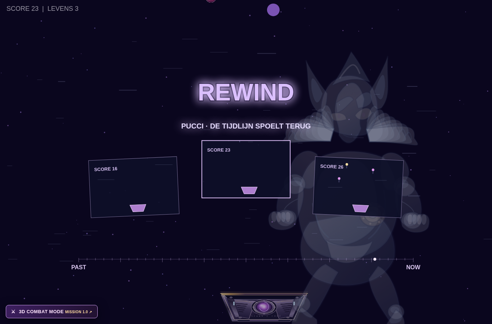

# Time Stop and Rewind visual polish — 13 October 2026

This update focuses on the normal Catcher game's Time Stop and Rewind presentation.

- Time Stop now has an engraved dial with minute marks, Roman numerals and layered metal rings. The World has additional segmented armour, fasteners and face seams, with a smaller composition that leaves more room around the figure.
- The frozen phase has its own fixed character pose, stationary dial and suspended glints over the visible paused arena. It no longer restarts the summon animation. The older overlapping Time Stop graphics are used only if the character director is unavailable.
- Rewind shows three framed memories from the recorded round, including the actual score, balls and catcher. Reverse light trails and a moving timeline replace the stack of clocks.
- Rebirth has diffuse nebula clouds and fine filaments in place of the wide, hard-edged light tubes.
- Gameplay rules, audio assets and phase durations are unchanged. Script cache versions were updated together.

The local suite passes, including 184 cinematic rendering calls across four viewport sizes, Arcade gameplay checks, 21 combat checks and audio lifecycle checks. The initial browser pass succeeded in [run 38316839459](https://github.com/RyanDb020/Catcher-JoJo/actions/runs/38316839459), including every Rewind phase, Time Stop, audio requests and return to gameplay. Its console, page, request and HTTP-error lists were empty. The follow-up moves the Rewind memories in front of the translucent figure and makes the frozen World figure opaque so its armour does not show overlapping internal lines.

Final browser verification: [run 38317319699](https://github.com/RyanDb020/Catcher-JoJo/actions/runs/38317319699), source revision `f1ecbad5dc90e61faa17e812b8c65b9ce6706be4`. Both jobs passed. Arcade console, page, request and bad-response lists are empty. All cinematic phases return to gameplay; the protected play segment lasted 10.018 seconds. This also ran the existing WebGL/layout/audio/fallback smoke checks, but did not repeat the five-wave mission for this visual-only Arcade update.

Actual browser captures, visually reviewed:

