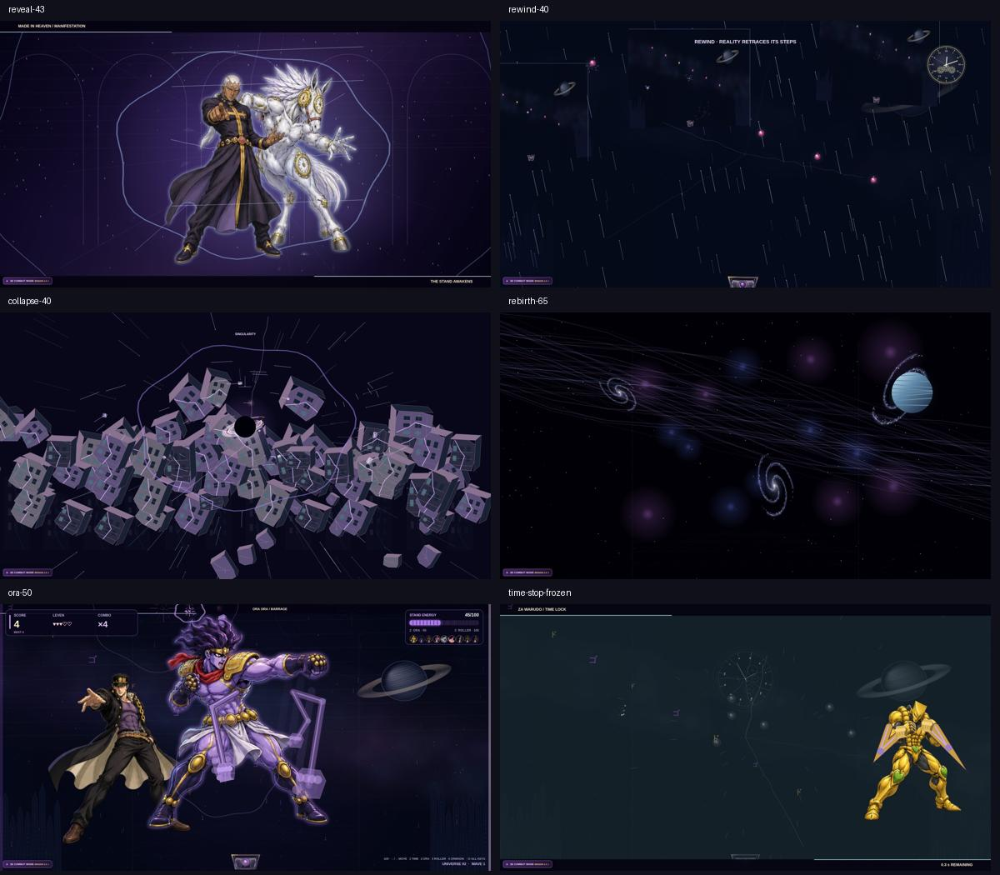

# VFX 5.0 — verified update, 13 October 2026

Continued the existing Game 1 from main d070c8eee53958e0059ced359c353a665a764acd. Production animation source: 79ebd94bfc82e7e8f053a2ce1f49d70b72f78e5a; subsequent commits change the browser proof/export harness. Existing gameplay, progression, settings, remappable controls, ten Stand pose atlases and all seventeen supplied JoJo MP3s are retained. No Game 2 replacement or separate demo.

## What actually changed

| Scene | Action, response and aftermath |
| --- | --- |
| Pucci / Made in Heaven | Energy converges, moving fractures open, the paired Stand materializes in layers, limbs/body react, pulses resolve into accelerated star streams. |
| Rewind | Recorded ball/catcher gameplay positions interpolate backwards across shifting past-data panels. Energy returns, stars reverse and timeline tears move. The clock is a secondary corner element. |
| Collapse / singularity | Shaking facades crack into independently rotating wall, roof and ground sections. Pieces rise then accelerate inward. Tilted accretion arcs, bent star paths, spirals and ingestion bursts culminate in darkness. |
| Rebirth | Darkness, pulsing seed, orbiting energy, explosion and expanding shock; stars settle, gas filaments and spiral galaxies form, a shaded planet appears, camera flight reveals the playable environment. |
| ORA | Reveal, first strikes, barrage, overdrive, finisher and 600 ms recovery. Alternating shoulder/elbow/wrist arcs, growing gauntlets, trails and timed impacts move continuously over retained character artwork. |
| Time Stop | Golden activation wave and distortion lead into desaturated frozen balls and particles. The World continues guard/command gestures; the existing slow opportunity follows, then an explosive time-resume cue restores motion. |
| Other attacks | MUDA/Giorno joint rigs, aligned Hand sweep, Tusk spiral, C-Moon upward energy and actual hit/Roller impact events share the bounded effects system. |

Collapse lasts 6.4 seconds and rebirth 8.5 seconds. Healthy longer voice playback controls animation duration; missing audio has a timed fallback. Native audio completion now tolerates a lagging capped physics clock without stranding a cinematic. Pause, reset, game over and skip clear or hold the correct states.

The shared Canvas engine uses eased seconds-based motion, cached glow/galaxy textures, a 24-hit pool, depth variation, camera response and impact trails. Desaturated game assets are cached rather than filtering the whole frame repeatedly. Reduced Effects is persisted in Options and suppresses flashes/shake while reducing geometry. Contact-glow onsets are rate-limited.

## Audio and rights

No new audio download, replacement voice, anime extract or external streaming URL was added by this VFX update. All 17 files in assets/jojo and all 10 WebP pose atlases have unchanged Git blob SHAs against the starting main. Existing Pucci, ORA, DIO/Time Stop variants, rewind, music and event mappings are retained; long variants continue through their full native playback.

Existing reveal/acceleration/reverse/impact/finisher and resume/rebirth effects use the local recordings/mixes already documented in ASSET_CREDITS.md. Kenney Impact Sounds and RPG Audio have preserved CC0 declarations in assets/foley. User-supplied JoJo voices have no verified redistribution licence; no free licence is claimed. This update did not re-download or re-license those files. The older AUDIO_CREDITS.md default-audio note is superseded by the personal-restoration note in ASSET_CREDITS.md.

Audio verification covered native decoding/playback, duration, pause/resume, missing files and duplicate/cleanup guards. Subjective listening and syllable-perfect voice/body synchronization were not verified.

## Tests actually executed

- Local npm test on the downloaded final branch: passed, exit 0. Existing gameplay/audio/3D regressions; 212 renderer checks over four viewports; ten atlases/240 crops; moving joint geometry, reverse gameplay history, hit bounds, freeze ages and reduced effects.
- Full source browser run [38408371527](https://github.com/RyanDb020/Catcher-JoJo/actions/runs/38408371527): Node, 3D/fallback, Arcade cinematics, missing audio, long ORA, all seventeen previews and six complete voice/control routes passed their steps. The overall run failed only at the added high-resolution ORA recovery screenshot capture, which missed the short recovery window during PNG encoding. That run is not called wholly successful.
- Follow-up JPEG proof runs [38410936419](https://github.com/RyanDb020/Catcher-JoJo/actions/runs/38410936419) and [38412237024](https://github.com/RyanDb020/Catcher-JoJo/actions/runs/38412237024): enabled Node and VFX browser jobs passed. These targeted runs do not rerun the whole audio/3D route.
- Final export run [38417724570](https://github.com/RyanDb020/Catcher-JoJo/actions/runs/38417724570): both enabled jobs passed. Recorded 2558×1390 viewport, muted playback, real-time full cinematic phases, reset returning to play, actual ball/particle freeze, Reduced Effects and pause. No page errors. No cinematic seeks or injected scene phases; ball fixtures were seeded then actually played for seven seconds to collect history.
- Final recorded headless frame-time median: 50 ms; p95: 116.7 ms. Recording/software rendering at this large viewport is not a player-device GPU benchmark. Performance on the user's machine remains unverified.

## Evidence

[Full browser results](qa/vfx5/results.json). The final workflow artifact **shattered-universe-3d-qa** contains all full-resolution JPEG phase shots and the complete muted **vfx5-muted-full-run.webm** recording. Download it from [the successful run](https://github.com/RyanDb020/Catcher-JoJo/actions/runs/38417724570) (artifact ID 11825425564). Artifact retention currently ends 11 January 2027.

The supplied 68.309-second, 2558×1390 clip was inspected as the visual baseline during implementation. These final screenshots match its viewport; they are different played rounds, not identical captured events. An exported before/after movie montage has not been completed.

## Honest limits

Rewind replays actual recorded positions and available gameplay data, not framebuffer footage; it does not undo saved scores or invent history when little was recorded. Destruction is stylized procedural Canvas geometry with facade/ground detail, not a physically simulated new 3D city. Character animation combines retained six-pose artwork with continuously moving joint overlays/body transforms; it is not a fully skinned character rig. These limitations remain visible and should guide any next art pass.
